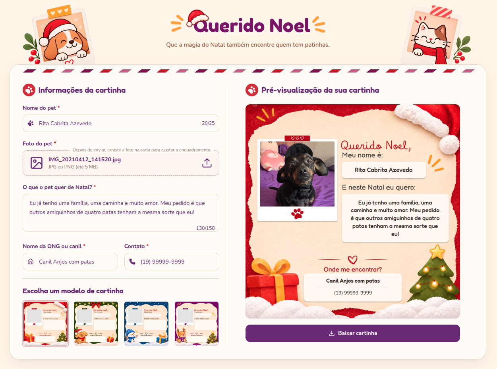

# 🎄 Querido Noel

Uma experiência web para criar cartinhas de Natal personalizadas para pets que
esperam por cuidado, apoio ou uma nova família.

<p align="center">
  
</p>

## Sobre o projeto

O **Querido Noel** nasceu para ajudar ONGs, canis e protetores independentes a
contarem a história de cada animal de uma forma carinhosa e fácil de compartilhar.
Em poucos passos, a pessoa adiciona as informações do pet, escolhe um modelo e
baixa uma cartinha pronta para publicar nas redes sociais.

Toda a criação acontece localmente no navegador: as informações preenchidas e a
foto selecionada não são enviadas para um servidor.

## ✨ Funcionalidades

- Preenchimento do nome, desejo, instituição e contato do pet;
- Upload de imagens JPG ou PNG com validação de formato, tamanho e dimensões;
- Reposicionamento da foto com mouse, toque ou teclado;
- Quatro modelos de cartinha: Classic, Gingerbread, Snowman e Reindeer;
- Pré-visualização atualizada em tempo real;
- Formatação e validação de telefone;
- Exportação da cartinha em PNG pronta para compartilhar;
- Interface responsiva para celular e desktop;
- Controles e mensagens preparados para tecnologias assistivas;
- Headers de segurança configurados para o Cloudflare Pages.

## 🛠️ Tecnologias

- [React](https://react.dev/) para construção da interface.
- [TypeScript](https://www.typescriptlang.org/) para tipagem e segurança do código.
- [Vite](https://vite.dev/) para desenvolvimento e build.
- [Tailwind CSS](https://tailwindcss.com/) para estilização responsiva.
- [html-to-image](https://github.com/bubkoo/html-to-image) para exportação da cartinha.
- [Lucide React](https://lucide.dev/) para os ícones.
- [Node.js Test Runner](https://nodejs.org/api/test.html) para os testes automatizados.
- ESLint e Prettier para qualidade e padronização.

## 🚀 Executando localmente

### Pré-requisitos

- Node.js 24 ou superior.
- npm.

### Instalação

```bash
git clone <URL_DO_REPOSITORIO>
cd querido-noel
npm install
npm run dev
```

O Vite mostrará no terminal o endereço local da aplicação.

## 🧪 Qualidade do código

```bash
npm test               # executa os testes automatizados
npm run lint           # verifica o código com ESLint
npm run format:check   # confere a formatação
npm run build          # gera e valida o build de produção
```

Para aplicar a formatação automaticamente:

```bash
npm run format
```

## ☁️ Deploy no Cloudflare Pages

O projeto foi hospedado no Cloudflare Pages.

---

Feito para ajudar a magia do Natal a encontrar quem tem patinhas. 🐾
